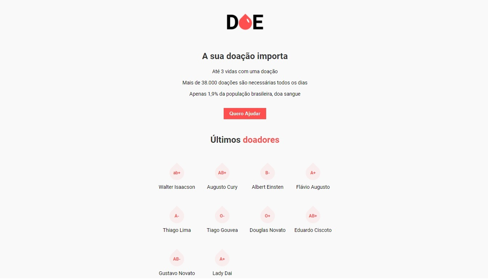

> **Projeto de estudo.** Estado conferido em 30/10/2026: 1 endereço(s) citado(s) abaixo não responde(m). Detalhes em [docs/AVALIACAO.md](docs/AVALIACAO.md) e próximos passos em [docs/PLANO-ESTRATEGICO.md](docs/PLANO-ESTRATEGICO.md).

<h1 align="center">Doe Sangue! Salve Vidas!</h1>

<p align="center">Lista de pessoas dispostas a doar sangue, com cadastro consentido e dados minimizados.</p>

<p align="center"></p>

## Problema e proposta

Apenas 1,4% da população brasileira doa sangue regularmente (Ministério da Saúde, 2022). A página convida a pessoa a entrar numa lista de doadores e mostra quantos doadores existem por tipo sanguíneo.

- **Público:** pessoas que querem doar; campanhas locais de doação.
- **Métrica de sucesso:** doadores cadastrados por semana e cobertura por tipo (`GET /health` e tabela por tipo).

## Funcionalidades

- Cadastro com nome, e-mail, tipo sanguíneo (A±, B±, AB±, O±) e **consentimento LGPD** obrigatório.
- Lista pública só com primeiro nome + inicial do sobrenome e tipo; e-mail nunca aparece.
- E-mail repetido não duplica o cadastro.
- Erros por campo, confirmação após o envio, páginas 404 e 503.

## Stack

Node 22 · Express 4 · Nunjucks · PostgreSQL 16 (pg) · helmet · node:test + supertest.

## Como rodar

```sh
npm install
cp .env.example .env      # ajuste DATABASE_URL
npm run dev               # cria/atualiza a tabela e sobe em http://localhost:3000
TEST_DATABASE_URL=postgres://postgres@localhost:5432/postgres npm test
```

## Em produção

- URL: https://doe-sangue-salve-vidas.onrender.com
- Hospedagem gratuita: Render (Web Service) + PostgreSQL no Neon, publicada a cada push na `master` pelo `render.yaml`.
- Passo a passo completo (Neon, Render, CI e conferência): [docs/DEPLOY.md](docs/DEPLOY.md).

## Documentação

[docs/ANALISE.md](docs/ANALISE.md) · [docs/ARQUITETURA.md](docs/ARQUITETURA.md) · [docs/PLANO-DE-ACAO.md](docs/PLANO-DE-ACAO.md) · [docs/DEPLOY.md](docs/DEPLOY.md)

Projeto da Maratona Dev (Rocketseat), evoluído por [@douglasabnovato](https://github.com/douglasabnovato).
