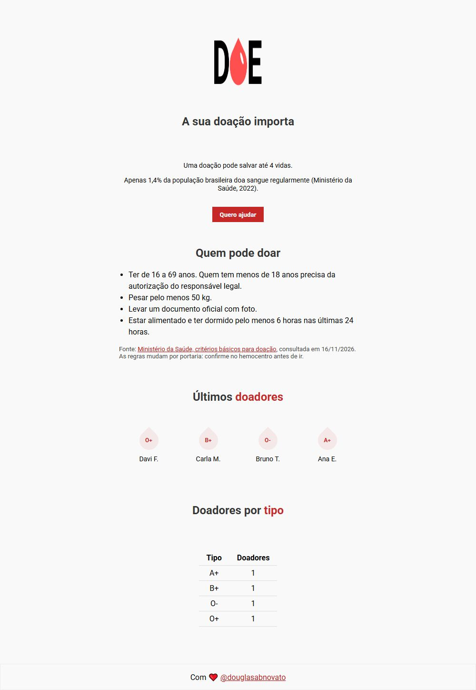

> **Projeto de estudo.** Estado conferido em 16/11/2026: o endereço antigo segue fora do ar e não aparece como link. Detalhes em [docs/AVALIACAO.md](docs/AVALIACAO.md) e próximos passos em [docs/PLANO-ESTRATEGICO.md](docs/PLANO-ESTRATEGICO.md).

<h1 align="center">Doe Sangue! Salve Vidas!</h1>

<p align="center">Lista de pessoas dispostas a doar sangue, com cadastro consentido e dados minimizados.</p>

<p align="center"></p>

## Estado e próximos passos (ciclo de 16/11/2026)

**Estado em 16/11/2026:** Estudo (N1), 9 de 10 critérios aplicáveis atendidos; **Finalizado: sim**. O que falta (critério 9) depende do responsável (#22 e #24). Detalhes em [`docs/MVP.md`](docs/MVP.md).

**Sem link publicado:** `https://doe-sangue-salve-vidas.onrender.com` respondeu 404 em 16/11/2026; o serviço não existe (#16). Para ver a tela sem banco, rode `npm run demo`.

**O que foi feito**
- PR #21 (16/11/2026): teste no navegador com Playwright e axe no CI, com PostgreSQL 16 (job `e2e`); página em português para o excesso de envios (429); seção "Quem pode doar" com fonte do Ministério da Saúde (#13); servidor, página e CI antigos removidos da raiz (#15); captura do README com dados fictícios; `npm audit` no CI; patch do `pg`; logo sem distorção.
- PR #19 (10/11/2026): critério 10 com a `master` protegida (#14).
- PR #17 (06/11/2026): modo demonstração em memória e testes de integração rodando no CI.
- Antes: licença MIT (#5) e o que aprendi (#4).

**O que queremos fazer**
- #22 Decidir sobre os dados pessoais no histórico do Git (responsável).
- #23 Exigir o job `e2e` no ruleset da `master` (responsável).
- #24 Ligar os alertas do Dependabot (responsável).
- #16 Decidir a publicação no Render (responsável; passo a passo em [`docs/DEPLOY.md`](docs/DEPLOY.md)).
- #10 Ver o cadastro com PostgreSQL no computador local (responsável).
- #11 Oferecer `docker-compose.yml` com o PostgreSQL.
- #12 Permitir que a pessoa saia da lista.
- #25 Atualizar para Express 5 e `express-rate-limit` 8.
- #26 Oferecer tema escuro, com axe nos dois temas.

**Onde está a documentação**
- Estado dos critérios: [`docs/MVP.md`](docs/MVP.md)
- Plano do ciclo: [`docs/PLANO-DE-ACAO.md`](docs/PLANO-DE-ACAO.md)
- Arquitetura e decisões: [`docs/ARQUITETURA.md`](docs/ARQUITETURA.md)
- Publicação passo a passo: [`docs/DEPLOY.md`](docs/DEPLOY.md)

## 🧠 O que aprendi

> Proposta de 01/11/2026, escrita a partir do código e das dependências. Ajuste com a sua experiência.

- Renderizar páginas no servidor com Express e Nunjucks.
- Persistir dados em PostgreSQL com `pg`.
- Limitar envios com `express-rate-limit`.
- Testar a aplicação com `node --test` e, no navegador, com Playwright e axe.

## Problema e proposta

Apenas 1,4% da população brasileira doa sangue regularmente (Ministério da Saúde, 2022). A página convida a pessoa a entrar numa lista de doadores e mostra quantos doadores existem por tipo sanguíneo.

- **Público:** pessoas que querem doar; campanhas locais de doação.
- **Métrica de sucesso:** doadores cadastrados por semana e cobertura por tipo (`GET /health` e tabela por tipo).

## Funcionalidades

- Cadastro com nome, e-mail, tipo sanguíneo (A±, B±, AB±, O±) e **consentimento LGPD** obrigatório.
- Lista pública só com primeiro nome + inicial do sobrenome e tipo; e-mail nunca aparece.
- E-mail repetido não duplica o cadastro.
- Erros por campo, confirmação após o envio, páginas 404, 429 e 503.
- Seção "Quem pode doar" com os critérios básicos e link para o Ministério da Saúde.

## Stack

Node 22 · Express 4 · Nunjucks · PostgreSQL 16 (pg) · helmet · node:test + supertest · Playwright + axe.

## Como rodar

```sh
npm install
cp .env.example .env      # ajuste DATABASE_URL
npm run dev               # cria/atualiza a tabela e sobe em http://localhost:3000
TEST_DATABASE_URL=postgres://postgres@localhost:5432/postgres npm test
```

Sem PostgreSQL:

```sh
npm run demo              # dados só em memória, em http://localhost:3000
npm test                  # 7 testes; os 4 de banco ficam pulados
npx playwright install chromium
npm run test:e2e          # cadastro no navegador, com axe (modo demonstração na porta 3210)
```

## Publicação

- Fora do ar desde a conferência de 31/10/2026; para ver o projeto, rode localmente (seção "Como rodar").
- Hospedagem prevista: Render (Web Service) + PostgreSQL no Neon, publicada a cada push na `master` pelo `render.yaml`.
- Passo a passo completo (Neon, Render, CI e conferência): [docs/DEPLOY.md](docs/DEPLOY.md).

## Documentação

[docs/ANALISE.md](docs/ANALISE.md) · [docs/ARQUITETURA.md](docs/ARQUITETURA.md) · [docs/PLANO-DE-ACAO.md](docs/PLANO-DE-ACAO.md) · [docs/DEPLOY.md](docs/DEPLOY.md)

Projeto da Maratona Dev (Rocketseat), evoluído por [@douglasabnovato](https://github.com/douglasabnovato).
