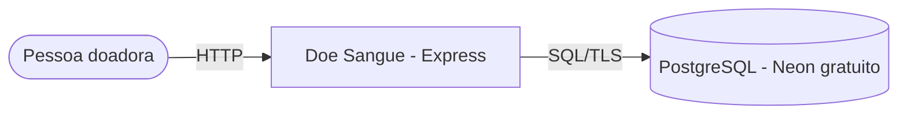
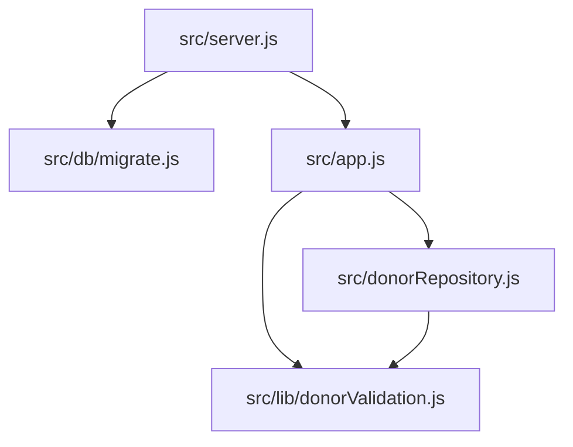

# Arquitetura — Doe Sangue! Salve Vidas!

## 1. C4

| Contêiner | Tecnologia | Responsabilidade |
|---|---|---|
| Web | Node 20, Express 4, Nunjucks | Página, validação, consentimento |
| Banco | PostgreSQL 16 | Doadores |
| Hospedagem | Render Web Service (gratuito) + Neon (gratuito) | Execução e dados |

## 2. Modelo de dados

| Coluna | Tipo | Regra |
|---|---|---|
| id | SERIAL PK | — |
| name | TEXT | 3–80 (aplicação) |
| email | TEXT | único por `lower(email)` entre consentidos |
| blood | TEXT | A±, B±, AB±, O± |
| consent_at | TIMESTAMPTZ | data do consentimento; `NULL` = legado, nunca exibido |
| created_at | TIMESTAMPTZ | `now()` |

Índices parciais (`WHERE consent_at IS NOT NULL`) para unicidade e ordenação.

## 3. Contratos

| Rota | Resposta |
|---|---|
| `GET /` | 200 página com últimos 8 (nome minimizado) e contagem por tipo |
| `POST /` | 303 `/?status=ok` · 303 `/?status=existente` · 422 com erros · 429 (5/min) |
| `GET /health` | 200 `{ status, donors }` |
| Falha de banco | 503 página amigável |

## 4. ADRs

- **ADR-001 — Consentimento explícito e minimização.** O tipo sanguíneo é dado de saúde (LGPD art. 11). O cadastro exige checkbox não pré-marcado; a lista pública mostra só "Primeiro S." e o tipo. E-mail nunca é exibido.
- **ADR-002 — Registros legados sem consentimento ficam ocultos.** A migration adiciona `consent_at`; linhas antigas (`NULL`) não aparecem até o titular se recadastrar.
- **ADR-003 — Migrations idempotentes na subida.** `IF NOT EXISTS` permite rodar a cada deploy sem ferramenta extra.
- **ADR-004 — Testes com PostgreSQL real.** O CI sobe um serviço Postgres; localmente, `TEST_DATABASE_URL`. Sem a variável, os testes de banco são pulados (não falham).
- **ADR-005 — Neon em vez de Render Postgres.** O Postgres gratuito do Render expira; o Neon mantém o plano gratuito sem prazo.

## 5. Fora do escopo

Remoção self-service dos dados (hoje por e-mail ao responsável), integração com hemocentros, lembrete de próxima doação (intervalo de 60/90 dias).
